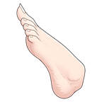

# 🐾 CurseurLapin

Un lanceur Windows pour remplacer les curseurs système par un thème **pieds / stylo tenu par un pied**, en couleurs chair, avec réglage de la taille d'affichage.



## Fonctionnalités

- **15 curseurs Windows personnalisés** (144×144) : flèche, lien, texte, attente animée, déplacement, redimensionnement, etc.
- **Lanceur graphique** `EquipeCurseurLapin.exe` :
  - Appliquer tous les curseurs PIEDS
  - Restaurer les curseurs Windows d'origine
  - Cycle automatique toutes les 5 s (PIEDS / Windows)
  - Appliquer uniquement le curseur principal
  - Choisir la taille d'affichage Windows (`32 / 48 / 64 / 96 / 128 px`)
  - Lancer au démarrage de Windows (option)
- Les **points chauds** (hotspots) sont placés sur la partie fonctionnelle de chaque dessin (gros orteil ou pointe du stylo).

## Utilisation

1. Double-cliquer sur `EquipeCurseurLapin.exe`.
2. Cliquer sur **« Appliquer TOUS les curseurs PIEDS »**.
3. Ajuster la taille avec le bouton **« Taille Windows »** si besoin.

> **Note importante :** Windows redimensionne les curseurs selon `HKCU\Control Panel\Cursors\CursorBaseSize`. Agrandir les fichiers `.cur` ne suffit pas ; le bouton « Taille Windows » modifie directement ce réglage.

## Structure du dépôt

| Chemin | Contenu |
|---|---|
| `EquipeCurseurLapin.cs` | Code source du lanceur (C# / WinForms, .NET Framework 4) |
| `EquipeCurseurLapin.exe` | Lanceur compilé, prêt à l'emploi |
| `curseurs/` | Les 13 `.cur` et 2 `.ani` du thème |
| `curseurs/previews/` | Aperçus PNG de chaque curseur |
| `LISEZ-MOI-curseur.txt` | Documentation détaillée en français |

## Compilation

Le lanceur est compilé avec le compilateur C# fourni avec le .NET Framework (Windows) :

```powershell
& 'C:\Windows\Microsoft.NET\Framework64\v4.0.30319\csc.exe' `
  /nologo /target:winexe /out:EquipeCurseurLapin.exe `
  /r:System.Windows.Forms.dll /r:System.Drawing.dll `
  EquipeCurseurLapin.cs
```

## Images sources

- `5x3-grid-of-15.jpg` — grille d'origine (Grok) pour les 15 curseurs PIEDS
- `keep-the-exact-same.jpg` — utilisé pour la sélection normale, le lien, le déplacement et l'attente animée
- `Gemini_Generated_Image_sejxepsejxepsejx.jpg` — utilisé pour le curseur de texte (I-beam)

Le fond damier des images a été converti en transparence ; les couleurs chair d'origine sont conservées.

## Licence

Projet personnel — libre d'utilisation.
